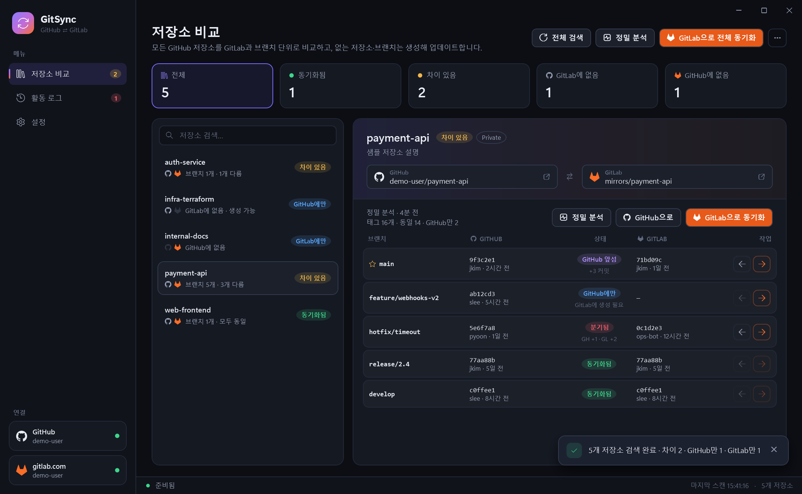
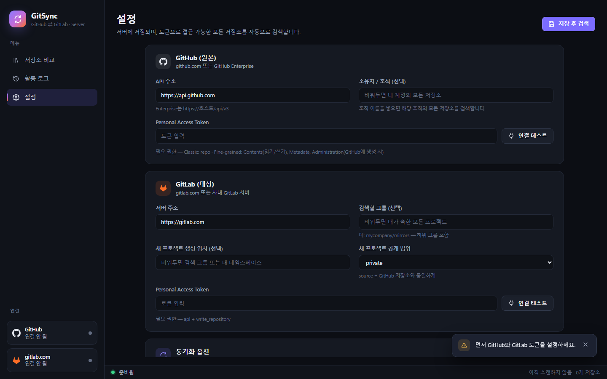

<p align="center"></p>

<h1 align="center">GitSync</h1>
<p align="center"><b>GitHub ⇄ GitLab 저장소 비교 · 동기화 도구</b><br>
모든 저장소를 자동 검색해 브랜치 단위로 비교하고, GitLab에 없는 저장소·브랜치는 생성해서 업데이트합니다.</p>

<p align="center">
  <a href="../../releases/latest"><b>⬇ GitSync.exe 다운로드 (Windows)</b></a> ·
  <a href="#서버-배포-podman--nginx">서버 배포</a> ·
  <a href="#동작-방식">동작 방식</a>
</p>



## 주요 기능

- **전체 자동 검색** — 토큰으로 접근 가능한 모든 GitHub 저장소와 GitLab 프로젝트를 찾아 이름으로 짝을 맞춥니다. 저장소를 하나씩 등록할 필요가 없습니다. (조직/그룹 필터, 이름 매핑 지원)
- **브랜치 단위 비교** — 브랜치마다 `동일 / GitHub 앞섬 / GitLab 앞섬 / 분기됨 / 한쪽에만 있음` 상태와 앞선 커밋 수, 마지막 커밋 작성자·시간을 보여줍니다. 태그도 비교합니다.
- **GitLab으로 푸시** — 없는 프로젝트는 자동 생성하고, 없는 브랜치는 만들고, 뒤처진 브랜치는 fast-forward로 업데이트합니다. 누락된 태그도 함께 푸시합니다.
- **안전한 기본값** — 분기된 브랜치는 절대 자동으로 덮어쓰지 않습니다. 브랜치별 버튼으로 확인 창을 거쳐야만 강제 푸시합니다.
- **역방향(GitLab → GitHub)** 동기화도 지원합니다.
- **두 가지 실행 방식**
  - **Windows 데스크톱 앱** (WPF, 단일 exe, .NET 설치 불필요)
  - **서버 모드** — podman 컨테이너(API) + nginx(웹 UI). 주기적 자동 동기화를 설정할 수 있습니다.
    서버는 **WPF 앱(설정 → 실행 위치 → GitSync 서버에 연결)** 또는 브라우저로 제어합니다.
- **토큰 보호** — 데스크톱은 Windows DPAPI로 암호화 저장, git 명령에는 환경변수로만 전달되어 명령줄이나 git 설정에 남지 않습니다.

## 빠른 시작 (Windows)

1. [Releases](../../releases/latest)에서 `GitSync.exe`를 받아 실행합니다. ([Git for Windows](https://git-scm.com/download/win)가 설치되어 있어야 합니다.)
2. **설정**에서 입력합니다.
   - GitHub: API 주소(기본 `https://api.github.com`), Personal Access Token
   - GitLab: 서버 주소(예: `https://gitlab.mycompany.com`), Personal Access Token
3. **저장 후 검색** → 모든 저장소가 비교됩니다.
4. **GitLab으로 전체 동기화**를 누르면 확인 창에 작업 내용이 표시되고, 승인하면 실행됩니다.

### 필요한 토큰 권한

| 서비스 | 권한 |
|---|---|
| GitHub (classic) | `repo` |
| GitHub (fine-grained) | Contents: Read/Write, Metadata: Read, (GitHub에 저장소를 만들 때) Administration: Write |
| GitLab | `api`, `write_repository` — 그룹에 생성하려면 해당 그룹 Developer 이상 |

## 서버 배포 (podman + nginx)

```
 브라우저 ──▶ nginx (NAME-web, :80) ──/api──▶ GitSync API (NAME-api, :8080) ──▶ git / GitHub / GitLab
                └────────────── podman pod: NAME-pod ──────────────┘
```

서버(Linux, podman 설치)에서:

```bash
git clone <이 저장소> gitsync && cd gitsync
./deploy/deploy.sh -n gitsync -t 1.0.0 -p 8080
```

Windows에서 원격 서버로 바로 배포 (소스를 복사한 뒤 **그 서버에서** 빌드·실행):

```powershell
.\deploy\deploy.ps1 -Server user@10.0.0.5 -Name gitsync -Tag 1.0.0 -Port 8080
# 또는 Linux/macOS:  ./deploy/deploy.sh -H user@10.0.0.5 -n gitsync -t 1.0.0
```

| 옵션 | 설명 | 기본값 |
|---|---|---|
| `-n NAME` | 이미지/pod 이름. `NAME-api`, `NAME-web` 이미지와 `NAME-pod`가 만들어집니다 | `gitsync` |
| `-t TAG` | 이미지 태그 | `latest` |
| `-p PORT` | 웹 UI 포트 | `8080` |
| `-d DIR` | 데이터(설정·캐시) 디렉터리 | `~/.local/share/NAME` |
| `-k KEY` | 웹/API 접근 키 (없으면 생성해서 `DIR/access-key`에 저장) | 자동 |
| `-H HOST` | 원격 서버(ssh)로 복사 후 그곳에서 빌드·실행 | — |

**같은 이름의 기존 이미지가 podman에 있으면 (태그와 관계없이) 그 이미지와 이를 사용하는 컨테이너·pod를 먼저 삭제한 뒤** 새로 빌드합니다.

배포가 끝나면 WPF 앱의 **설정 → 실행 위치 → GitSync 서버에 연결**에 서버 주소와 접근 키를 넣거나, 브라우저로 `http://서버:8080`에 접속해 접근 키를 입력하고, 설정 화면에서 토큰을 저장하면 됩니다. 토큰은 환경변수(`GITSYNC_GITHUB_TOKEN`, `GITSYNC_GITLAB_TOKEN`, `GITSYNC_GITLAB_URL` …)로도 줄 수 있습니다.



### 서버 API

| Method | Path | 설명 |
|---|---|---|
| GET | `/api/status` | 연결 상태, 실행 중 작업, 통계 |
| POST | `/api/scan` | 전체 검색 + 빠른 비교 |
| POST | `/api/analyze` | `{ids?}` 정밀 분석 |
| POST | `/api/sync` | `{ids?, from: "github"\|"gitlab"}` 동기화 (없으면 생성) |
| POST | `/api/push` | `{id, branch, from, force}` 단일 브랜치 푸시 |
| GET | `/api/repos`, `/api/repo?id=` | 목록 / 상세(브랜치) |
| GET/PUT | `/api/settings` | 설정 (토큰은 쓰기 전용) |
| GET | `/api/logs?after=` | 활동 로그 |

`GITSYNC_ACCESS_KEY`가 설정되면 모든 요청에 `X-Access-Key` 헤더가 필요합니다.

## 동작 방식

1. GitHub/GitLab REST API로 저장소 목록과 브랜치 head SHA를 가져와 빠르게 비교합니다.
2. **정밀 분석/동기화** 시에는 저장소마다 로컬 bare 미러(캐시)에 양쪽을 `fetch`하여
   `git rev-list --left-right --count`로 정확한 앞섬/뒤처짐을 계산합니다.
3. 푸시 계획:
   - 대상에 없는 브랜치 → **생성**
   - 대상이 뒤처짐 → **fast-forward**
   - 대상이 앞서거나 분기됨 → **건너뜀** (개별 강제 푸시만 가능)
   - 대상에만 있는 브랜치 → 건드리지 않음

## 소스에서 빌드

```bash
dotnet build GitSync.sln
dotnet run --project src/GitSync.Desktop                     # 데스크톱
GITSYNC_WEB_ROOT="$PWD/web" dotnet run --project src/GitSync.Server # 서버 + 웹 UI (nginx 없이, 절대 경로 필요)

# 단일 exe
dotnet publish src/GitSync.Desktop -c Release -r win-x64 --self-contained -p:PublishSingleFile=true -o publish
```

| 경로 | 내용 |
|---|---|
| `src/GitSync.Core` | 비교·동기화 엔진 (GitHub/GitLab API, git CLI) |
| `src/GitSync.Desktop` | WPF 데스크톱 앱 |
| `src/GitSync.Server` | ASP.NET Core API 서버 |
| `web/` | 웹 프론트엔드 (nginx 정적 파일) |
| `deploy/` | Containerfile, nginx.conf, podman 배포 스크립트 |

요구 사항: .NET 10 SDK, git 2.31+

## 검수

[docs/QA-PLAN.md](docs/QA-PLAN.md) — 검수 계획과 결과 (자동 시험 23건 + 실제 브라우저/화면 시험)

## 라이선스

[MIT](LICENSE)
